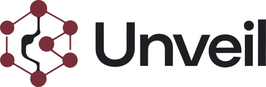
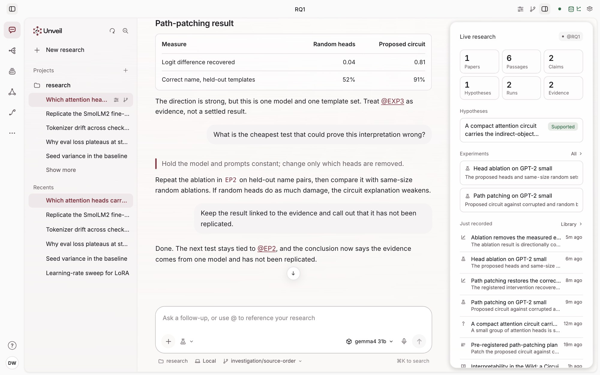
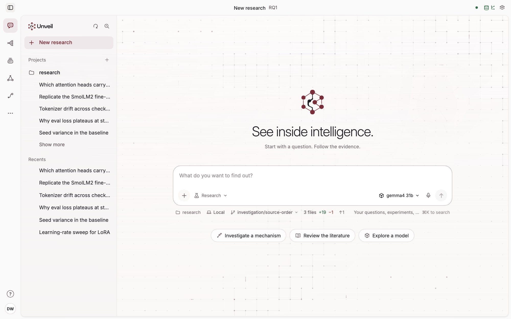
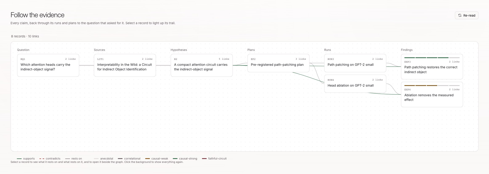
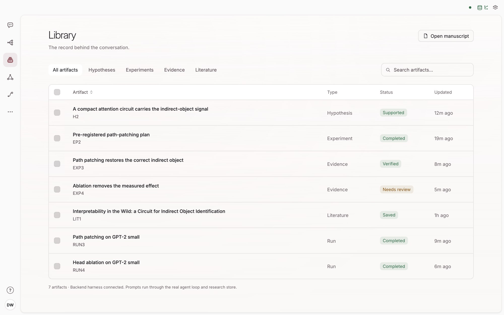
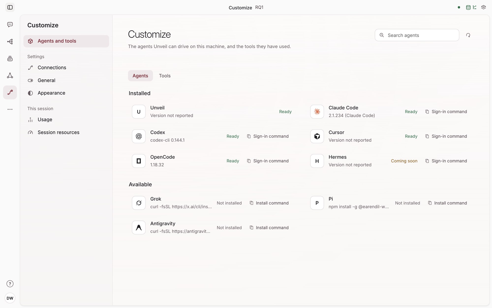

<div align="center">
  <picture>
    <source media="(prefers-color-scheme: dark)" srcset="docs/images/unveil-lockup-reversed.svg">
    
  </picture>
  <h3>See inside intelligence.</h3>
  <p>A research workspace for investigating model behavior.<br>
  Ask a question, run the experiments, and keep a record of what was tried and what it showed.</p>
  <picture>
    <source media="(prefers-color-scheme: dark)" srcset="docs/images/unveil-conversation-dark.jpg">
    
  </picture>
  <p>
    <b><a href="#download">Download →</a></b> ·
    <a href="#get-started">Get started</a> ·
    <a href="#questions">Questions</a>
  </p>
</div>

**Unveil is where a model-behavior question turns into evidence you can audit.** Ask it like you'd
ask a colleague. An agent reads the literature, states a hypothesis, commits a plan, runs the
experiment on your machine or your GPUs, and keeps everything as a typed record, so any claim can be
traced back through its runs and plans to the question that asked for it.

This repository hosts Unveil's public downloads. The source code is not published here.

## Download

Get the installer for your platform from the [latest release](https://github.com/own-path/unveil-public/releases/latest).

| Platform | Download | Install |
| --- | --- | --- |
| macOS, Apple Silicon | [Unveil-macos-arm64.dmg](https://github.com/own-path/unveil-public/releases/latest/download/Unveil-macos-arm64.dmg) | Open the disk image and drag Unveil to Applications. |
| macOS, Intel | [Unveil-macos-x64.dmg](https://github.com/own-path/unveil-public/releases/latest/download/Unveil-macos-x64.dmg) | Open the disk image and drag Unveil to Applications. |
| Linux x86_64 (Debian, Ubuntu) | [Unveil-linux-x64.deb](https://github.com/own-path/unveil-public/releases/latest/download/Unveil-linux-x64.deb) | `sudo apt install ./Unveil-linux-x64.deb` |
| Linux x86_64 (AppImage) | [Unveil-linux-x64.AppImage](https://github.com/own-path/unveil-public/releases/latest/download/Unveil-linux-x64.AppImage) | `chmod +x Unveil-linux-x64.AppImage`, then run it. |
| Windows x86_64 | [Unveil-windows-x64-setup.exe](https://github.com/own-path/unveil-public/releases/latest/download/Unveil-windows-x64-setup.exe) | Run the installer. It installs for the current user. |

[SHA256SUMS.txt](https://github.com/own-path/unveil-public/releases/latest/download/SHA256SUMS.txt)
lists a checksum for every file. To check a download:

```bash
shasum -a 256 -c SHA256SUMS.txt --ignore-missing   # macOS
sha256sum -c SHA256SUMS.txt --ignore-missing       # Linux
```

**The first launch may need your approval.** The macOS app is not yet notarized and the Windows
installer is not yet code-signed, so the system warns you once:

- **macOS:** if Unveil "can't be opened", open System Settings → Privacy & Security, scroll to the
  message about Unveil and choose **Open Anyway**.
- **Windows:** if SmartScreen stops the installer, choose **More info**, then **Run anyway**.
- **Linux:** the app needs the WebKitGTK 4.1 runtime and a desktop session. The AppImage may also
  need FUSE support from your distribution.

**Updates come to you.** Unveil checks this repository's releases for new versions and shows when
one is ready; you choose when to install it. Every update package is signed, and the app checks the
signature against the key built into it before installing.

## Get started

1. **Open Unveil.** It starts its own research harness, so there's nothing else to install or
   run. Your research is kept in `~/Unveil` (your home folder) until you open another folder.
2. **Give it a model.** Sign in to an agent CLI you already use (Claude Code, Codex, Cursor or
   OpenCode; Settings shows which ones it found and how to sign in), add an API key for a model
   provider, or connect a local open-weights server such as LM Studio or Ollama. Keys are stored in
   your operating system's keychain.
3. **Ask a question.** Start small and checkable, for example *"Is 2^61 − 1 prime?"*, and look at
   the record it leaves.

Experiments on models run in Python on your machine. They need Python 3.10 or newer (3.11
recommended) and optional ML packages.

<p align="center">
  <picture>
    <source media="(prefers-color-scheme: dark)" srcset="docs/images/unveil-home-dark.jpg">
    
  </picture>
</p>

## What it does

- **A record, not a chat log.** Questions, hypotheses, plans, runs, evidence and claims are kept as
  linked records on your disk. Refer to any of them in the conversation, as `@H2` or `@EXP4`.
- **Experiments that leave evidence.** Each run gets a fresh interpreter, its own directory and seed,
  and records its metrics, per-example scores, files and environment.
- **The plan comes first.** A plan is committed before its run, and a run can't be edited after.
  "It improved" is answered with an interval, not a single number.
- **Long work doesn't block you.** Runs survive the app quitting, background helpers report back
  when they finish, and a campaign can keep working one question for hours or days.
- **Your models, your tools.** Model APIs, a ChatGPT plan, local models or an agent CLI you already
  use. Connect MCP servers to give the agent your own tools and data.

**Follow the evidence.** Every record is linked to what it rests on. Select one and its whole trail
lights up, back to the question and forward to the findings.

<p align="center">
  <picture>
    <source media="(prefers-color-scheme: dark)" srcset="docs/images/unveil-graph-dark.jpg">
    
  </picture>
</p>

<table>
  <tr>
    <td width="50%">
      <picture>
        <source media="(prefers-color-scheme: dark)" srcset="docs/images/unveil-library-dark.jpg">
        
      </picture>
      <p><b>The Library.</b> Every hypothesis, plan, run, piece of evidence and paper, filterable by
      kind. Something still needing review says so.</p>
    </td>
    <td width="50%">
      <picture>
        <source media="(prefers-color-scheme: dark)" srcset="docs/images/unveil-agents-dark.jpg">
        
      </picture>
      <p><b>Agents and tools.</b> The agent CLIs Unveil found on this machine, whether they are
      ready, and how to install the rest.</p>
    </td>
  </tr>
</table>

<p align="center"><sub>Screenshots use the app's sample workspace, so their numbers are illustrative.</sub></p>

## Questions

**What does it cost?** Unveil doesn't sell tokens. You pay your model provider, use a plan or CLI
you already have, or run local models for free. The Usage page shows what each research spent.

**Does my research leave my machine?** The record stays on your disk. What you ask goes to the
model provider you chose.

**Do I need a GPU?** No. Small models run locally. For bigger ones, point Unveil at your GPU
machines.

**Does it work on Windows?** The app runs on Windows with the agent CLI providers. Local research
experiments currently need macOS or Linux.

**Why do I see "Veil" in places?** It's the project's earlier name.

## Terminal app (2026.4)

The April 2026 terminal release is still available for macOS and Linux:

```bash
curl -fsSL https://raw.githubusercontent.com/own-path/unveil-public/main/install.sh | sh
```

It installs the newest terminal release (currently
[v2026.4.25](https://github.com/own-path/unveil-public/releases/tag/v2026.4.25)) into
`~/.local/share/unveil` and links `unveil` into `~/.local/bin`, without `sudo`. Remove it with
`rm -rf ~/.local/bin/unveil ~/.local/share/unveil`. The desktop app above is where new work happens.

## Support

- **Problems and feedback:** open an issue in this repository.
- **Security reports:** email security@4thwall.dev rather than filing a public issue.

## License

Proprietary, 4thWall Labs. All rights reserved. The downloads are provided for your own use; no
redistribution rights are granted. See [LICENSE](LICENSE).
